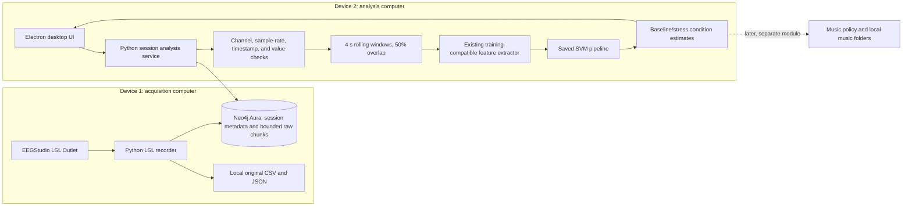

# Device separation and responsibilities

## Device 1 — acquisition and storage

EEGStudio publishes its selected EEG stream through LSL. Device 1 runs the
existing acquisition CLI in `record` mode, so it records without running the
classifier. Original samples and LSL timestamps are written locally; session
metadata and a configured bounded prefix of samples are sent to Neo4j Aura.
Use `apps/device1-recorder/README.md` for commands.

## Device 2 — retrieval, inference, and UI

The Electron application lists sessions that contain raw EEG chunks. On
selection, it asks `src/dashboard/device2_service.py` to retrieve the stored
session and run the existing `TrainedModel` and `RollingWindowBuffer` code.
Channel mapping is based on stored labels. The rate, finite values, timestamps,
and sample count are checked before predictions are generated. `window_features`
remains the only feature implementation; the UI does not recalculate features.

## Data flow

## Current storage boundary

The existing raw-to-Aura path supports bounded sample storage for prototype
testing. It is not a design validation for indefinite high-rate EEG storage.
The Device 1 command should retain local CSV as the durable source recording.
At larger scale, keep Neo4j for session, participant, event, and prediction
relationships and evaluate a signal-oriented store for continuous raw samples.

Each device requires its own local credentials file and installed runtime.
Secrets are never embedded in Electron renderer code or committed to source
control. Predictions remain preliminary experimental-condition estimates;
music must not be automated from them until the model and policy are separately
validated.
